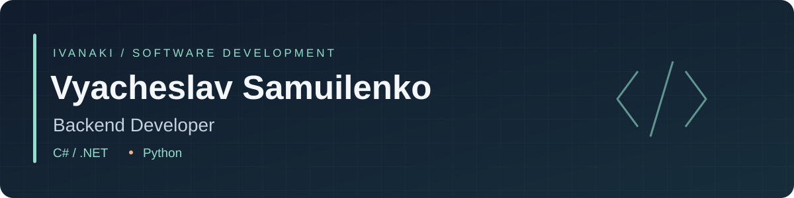

  

  <b>English</b> · <a href="README.ru.md">Русский</a>

## About me

I'm a **backend developer** and a student at **Central University**.

My background is in **C# and Unity**. I'm expanding into backend and broader software development, with a focus on APIs, databases and application architecture.

## Selected projects

### [GameMarket Backend](https://github.com/Ivanaki/GameMarketBackend)

A backend project for a game catalogue, with endpoints for listing, creating, updating and deleting games, plus image uploads and PostgreSQL persistence.

**C# · ASP.NET Core · Entity Framework Core · PostgreSQL**

Separate API, application, domain and data access layers, with services and repositories wired through dependency injection.

<a href="https://github.com/Ivanaki/GameMarketBackend/blob/main/GameMarket/GameMarket.API/Controllers/GamesController.cs">API controller</a> · <a href="https://github.com/Ivanaki/GameMarketBackend/blob/main/GameMarket/GameMarket.DataAccess/Repositories/GamesRepository.cs">Data access</a>

### [Paws&Parcels](https://github.com/Ivanaki/Paws-Parcels)

A 3D delivery adventure made by team **Coffeebreak** for the **National Technology Olympiad**. As the sole programmer, I built the quest, cargo and save systems, organised the service architecture and integrated the gameplay and UI into a complete MVP.

**C# · Unity · Zenject · MVVM · R3**

The team received special recognition from **Ninsar.Games**, leading to an internship.

## Technologies

| Area | Technologies |
| --- | --- |
| Languages | C#, Python |
| Backend & data | ASP.NET Core, Entity Framework Core, PostgreSQL |
| Games | Unity, Zenject, R3 |
| Architecture & tools | Service separation, dependency injection, MVVM, Git |

---

Explore the repositories above for source code, implementation details and project documentation.
