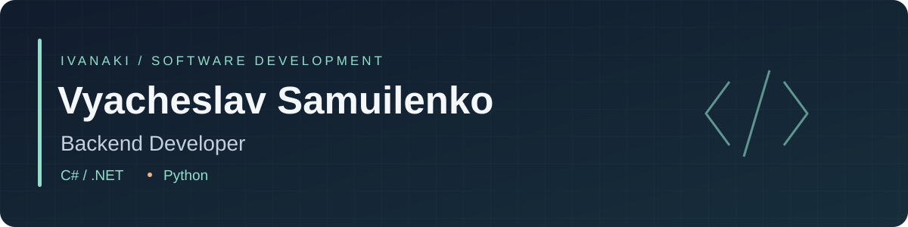

  

  <a href="README.md">English</a> · <b>Русский</b> &nbsp; | &nbsp;
  <a href="https://ivanaki.github.io/cv/resume-ru.pdf">Резюме · PDF</a> &nbsp; | &nbsp;
  <a href="#проекты">Проекты</a> · <a href="#образование">Образование</a> · <a href="#технические-навыки">Навыки</a>

Backend-разработка на **C#/.NET и Python**. Проектный опыт: REST API, реляционные базы данных, интеграции с Telegram и архитектура приложений, а также реализация игровых систем на Unity.

## Проекты

<table>
<tr>
<td width="50%" valign="top">

<h3><a href="https://github.com/Ivanaki/CU_Hack">Честный месяц</a></h3>

<b>Telegram-бот и Mini App · CU@Hack</b>

Учёт расходов с импортом выписок, распознаванием чеков и голосовым вводом. Учётная модель отделяет расходы от переводов между счетами.

<b>Python · FastAPI · aiogram · SQLAlchemy · SQLite</b>

<b>Роль:</b> участник команды. <b>Результат:</b> первое место; первоначальный рабочий прототип создан командой за шесть часов.

<a href="https://github.com/Ivanaki/CU_Hack">Проект и демо</a> · <a href="https://github.com/Ivanaki/CU_Hack/blob/main/app/service.py">Код backend</a> · <a href="https://github.com/Ivanaki/CU_Hack/blob/main/docs/API.md">API</a>

</td>
<td width="50%" valign="top">

<h3><a href="https://github.com/Ivanaki/Paws-Parcels">Paws&amp;Parcels</a></h3>

<b>Трёхмерная игра про доставку · НТО</b>

Готовый MVP: квесты, взаимодействие с грузами, физика транспорта и сохранение прогресса. Сервисная архитектура и реактивный интерфейс.

<b>C# · Unity · Zenject · MVVM · R3</b>

<b>Роль:</b> единственный программист, команда Coffeebreak. <b>Результат:</b> специальная номинация от Ninsar.Games и приглашение на стажировку.

<a href="https://github.com/Ivanaki/Paws-Parcels">Проект и геймплей</a> · <a href="https://github.com/Ivanaki/Paws-Parcels#inside-the-code">Обзор кода</a>

</td>
</tr>
</table>

## Образование

**Центральный университет · 2026–2030**  
Бакалавриат **«Математика и компьютерные науки»**, 02.03.01 · Обучение продолжается, ожидаемый выпуск — 2030 год

- **Программа:** [«Разработка»](https://cu.ru/bachelor/development).
- **Профессиональный фокус:** backend-разработка.
- **Основные дисциплины программы:** программирование, математический анализ, линейная алгебра, алгоритмы и структуры данных, базы данных, компьютерные сети и основы промышленной разработки.

## Технические навыки

| Категория | Технологии |
| --- | --- |
| Языки программирования | C#, Python |
| Backend и интеграции | ASP.NET Core, FastAPI, REST API, aiogram |
| Базы данных и ORM | PostgreSQL, SQLite, Entity Framework Core, SQLAlchemy |
| Архитектура | Разделение на сервисы, внедрение зависимостей, MVVM |
| Разработка игр | Unity, Zenject, R3 |
| Инструменты и проверка | Git, GitHub, Docker Compose, pytest |

<a href="https://ivanaki.github.io/cv/resume-ru.pdf"><b>Полное резюме · PDF</b></a> · <a href="https://ivanaki.github.io/cv/resume-en.pdf">Résumé in English · PDF</a>

